# Manual tests: smoke escalation

Covers the fire escalation in `home_assistant/packages/safety.yaml` — a smoke detector
going into alarm starts a countdown, and if nobody calls it off a panic is raised with the
olarm panel, the pedestrian gap is opened, the tenant is SMSed and the egress lights go
on.

These are manual because they exercise the parts the in-process suite deliberately does
not: real push notifications and their actions, the dashboard tiles, and the panel. The
automated tests in `packages/test_safety.py` cover the logic — run those first; these
confirm the wiring around it.

## The flow

How a countdown starts, and every way it can end:

```mermaid
---
title: Smoke escalation lifecycle
config:
  flowchart:
    nodeSpacing: 55
    rankSpacing: 55
    curve: linear
---
flowchart TD
    I((" ")):::initial
    I --> A1(["Detector changes state"])
    A1 --> A2(["Recount detectors in alarm"])
    A2 --> D1{"detectors<br/>in alarm"}

    D1 -->|"[= 1, idle]"| A3(["Stamp run record<br/>Start countdown<br/>Send cancellable prompt<br/>SMS the tenant: be ready"])
    D1 -->|"[≥ 2]"| ME{" "}
    D1 -->|"[= 0, all available]"| MC{" "}
    D1 -->|"[else]"| FF(("×")):::flowfinal

    A3 --> LA(["Put a Live Activity<br/>on the lock screen"])
    LA --> D2{"first<br/>event"}
    D2 -->|"[countdown expires]"| ME
    D2 -->|"[alert tapped]"| ME
    D2 -->|"[cancel tapped]"| MC
    D2 -->|"[panic by hand]"| MC

    ME --> A4(["Notify, raise panic, ACs off,<br/>open gap, lights on"])
    MC --> A5(["Stop countdown, clear prompt,<br/>confirm what was cancelled,<br/>SMS the tenant"])
    A4 --> LA2(["Clear the Live Activity"])
    A5 --> LA2

    LA2 --> F(((" "))):::final

    classDef initial fill:#000,stroke:#000
    classDef final fill:#000,stroke:#000
    classDef flowfinal fill:#fff,stroke:#000
```

Read as a UML activity diagram: filled circle is the initial node, rounded boxes are
actions, labelled diamonds are decision nodes and bare ones are merges, with the guards
in brackets on the edges, the crossed circle is a flow final (this change does nothing) and the ringed circle
is the activity final.

"Cancel When Smoke Clears" catches every route to 0, not only the one drawn: it triggers
on any change to the count sensor — attribute changes included — and decides in its
conditions, so there is no crossing to miss. One exception, deliberate: a detector that
goes `unavailable` while in alarm leaves the count at 0 with `unavailable` non-empty, and
the countdown runs on. That is what a fire looks like.

Inside the escalation, and where test mode does and does not apply:

```mermaid
---
title: script.escalate_smoke_alarm
config:
  flowchart:
    nodeSpacing: 55
    rankSpacing: 55
    curve: linear
---
flowchart TD
    I((" ")):::initial
    I --> A1(["Receive test_mode<br/>from the caller"])
    A1 --> D1{"panic in the<br/>last 5 min?"}
    D1 -->|"[yes]"| F1(((" "))):::final
    D1 -->|"[no]"| A2(["Cancel countdown,<br/>clear prompt"])

    A2 --> D2{"test_mode"}
    D2 -->|"[off]"| A3(["SMS the tenant:<br/>evacuate"])
    D2 -->|"[on]"| M1{" "}
    A3 --> M1

    M1 --> A4(["Send the critical push"])
    A4 --> D3{"test_mode"}
    D3 -->|"[off]"| A5(["Press the panic button"])
    D3 -->|"[on]"| M2{" "}
    A5 --> M2

    M2 --> D4{"nighttime?"}
    D4 -->|"[yes]"| A6(["Switch on yard<br/>and egress lights"])
    D4 -->|"[no]"| M3{" "}
    A6 --> M3

    M3 --> D5{"test_mode"}
    D5 -->|"[off]"| A7(["Switch off the ACs<br/>Open the pedestrian gap"])
    D5 -->|"[on]"| A8(["Clear the arming switch"])
    A7 --> M4{" "}
    A8 --> M4
    M4 --> F2(((" "))):::final

    classDef initial fill:#000,stroke:#000
    classDef final fill:#000,stroke:#000
```

The escalation is *told* whether this run is a rehearsal — it does not look a helper up
for itself. Callers after a countdown pass the run record; the second-detector shortcut,
which has no countdown and so no window for anything to change, passes the arming switch.

Who writes what:

| Helper | Written by | When |
|---|---|---|
| run record | `script.start_smoke_escalation` — **and nothing else** | every countdown start, from the arming switch |
| arming switch | `script.test_smoke_escalation` | Run Test turns it on |
| arming switch | `escalate_smoke_alarm`, `cancel_smoke_escalation`, Cancel When Smoke Clears, Cancel When Panic Raised | off, when a run ends |
| arming switch | Disable Stale Test Mode | off, after 5 min on, or on HA start |

Anything in the bottom three rows may fire at any moment, including mid-countdown. None
of it can reach the run record, which is the point.

## Read this first

Two helpers, and the difference between them is the whole design.

**`input_boolean.smoke_escalation_test_mode`** — the arming switch. What the *next*
rehearsal should be. Anyone may flip it at any moment, and it is what you turn on before
a manual run.

**`input_boolean.smoke_escalation_run_is_test`** — the run record. What the countdown
*currently in flight* already is. Stamped from the arming switch by
`script.start_smoke_escalation` when a countdown begins, and written by nothing else,
ever. This is what the escalation reads.

That split is why nothing can turn a drill into a real dispatch any more. It was added
after two of them: 2026-09-07 and 2026-09-09, both caused by a housekeeping automation
clearing the arming switch between a countdown starting and the escalation reading it.
The record cannot be reached that way. The Run Is Test row on the System dashboard is
read-only for the same reason.

**The arming switch is yours; only the 5 min backstop clears it.** A rehearsal ends by
clearing the *run record*, not the switch, so a session of attempts keeps its arming. It
did not always work that way: until 2026-09-18 every run consumed the switch, and a drill
went out for real because the next attempt began unarmed.

**Run Test starts its own 30 sec countdown.** It is not a way to arm for a manual run —
its countdown blocks yours from starting, and when it expires the run is over. For T5
onwards, arm with the toggle.

Test mode suppresses the three outward-facing steps — the panic, the tenant SMS and the
pedestrian gap — and prefixes notifications `[Test]`. It does **not** suppress anything
that presses `button.home_user_panic` directly: the dashboard Panic tile, a remote, the
panel itself. Those raise a real panic whatever it says.

Controls live on the **System** dashboard under "Smoke Escalation": Perform Smoke Test,
Test Mode, Run Is Test, Detectors In Alarm, Unavailable, Countdown. "Run Test" below is
shorthand for that first row. The countdown bar and the Cancel Fire Escalation tile appear
on the **Security** dashboard under Smoke Detectors while a countdown is running.

Never leave a forced detector state behind. Set it back to `off` when you are done.

**To shorten a countdown** rather than sit through three minutes, use the timer's
more-info dialog: enter a short duration and press **Set**. That calls `timer.start`,
which restarts it properly.

**What happens at the other end:** the control room treats a panic as dispatch-first. They
send a response and phone; an unanswered call does not call it off. A panic raised in
error costs a call-out, and the only way to stop one is to phone them.

**The panic is silent** — no panel siren. Do not use the siren as evidence that a test did
or did not escalate; go by the notifications and by `button.home_user_panic`'s state,
which holds the timestamp of its last press.

## How much these matter, given the unit tests

`tests/packages/test_safety.py` runs 32 tests in about four seconds against a real
Home Assistant, with no risk of a dispatch. Run it first — `pytest tests/packages`.

**The unit tests own the logic.** Countdown durations by presence, the 2-of-n threshold,
the 0 → 2 jump, panic on expiry, the suppression contract in both directions, the
unavailable/recovery pair, the backstop including its restart path, the run record, which
flag each caller reads, the panic-timestamp guard, and the Live Activity's start and both
endings. Every real defect found since 2026-09-07 is now pinned by one of them, and each
was mutation-checked — the config was broken on purpose to confirm the test fails.

**What they cannot reach, which is what these scenarios are for:**

| Gap | Why a unit test cannot close it |
|---|---|
| Push delivery | `notify.mobile_app_ceres` is mocked; whether it arrives, is critical, or is silent is the companion app's business |
| Notification actions | The buttons render on iOS; a test can only fire the event they would have produced |
| Live Activity rendering | The chronometer, the lock-screen layout and `live_update` are iOS features; the test asserts the payload, not the pixels |
| Tag clear/replace | The documented iOS quirk that a clear can take the next notification with it |
| Dashboard tiles | Visibility conditions, hold-plus-confirm, the custom cards |
| `device_class: smoke` | The filter is only as good as what the Shelly integration actually sets |
| Reaching the panel | That `button.press` leaves the property and arrives at the control room |

**Known gaps in both:**

- **Two real detectors tripping inside one state-machine cycle.** The pair of automations
  is unit tested together, so the logic is pinned either way the order falls. What nothing
  covers is whether two Shellys can actually report close enough together for HA to
  coalesce them into one state change.

**So:** the scenarios below are no longer where correctness is established — they confirm
the wiring at the edges the suite is blind to. Run the suite on every change; run these
after a deploy, and after any change to a notification, a tile or the panel.

## How each scenario is written

Each has **Preconditions** (the state to be in before you start), **Steps**, and
**Postconditions** (what must be true when it ends). Anything not listed as changing must
not change.

**Preconditions common to every scenario**, assumed unless a scenario overrides them:

- `sensor.smoke_detectors_in_alarm` is `0`, with `unavailable_count` `0`
- `timer.smoke_escalation` is `idle`
- `input_boolean.smoke_escalation_run_is_test` is `off`
- no forced states left over from an earlier scenario

**Invariants that must hold throughout all of them.** If one breaks, stop and report it
rather than carrying on:

- **I1** — The security company is contacted only when a countdown reaches its end with
  the run record `off`, or `ESCALATE_SMOKE_ALARM` is tapped, or a panic is raised by hand.
- **I2** — `input_boolean.smoke_escalation_run_is_test` changes only when a countdown
  starts or ends, or when the backstop clears a stale one (T10.1). Nothing else writes it.
- **I3** — `input_boolean.smoke_escalation_test_mode` changes only when you move it or
  the backstop clears it. **No run consumes it.**
- **I4** — While `timer.smoke_escalation` is `active`, exactly one cancellable prompt and
  one Live Activity exist. When it is `idle`, neither does.
- **I5** — The tenant is never contacted during a rehearsal.

## Quick rehearsals (Run Test)

Run Test switches test mode on and starts a fixed 30 sec countdown. It covers everything
downstream of the trigger, but not the trigger itself.

### T1: expiry

**Preconditions:** the common set. Test Mode may be either way — Run Test arms it.

**Steps:** System dashboard → Run Test. Do nothing for 30 sec.

**Postconditions:**
- countdown prompt: *"[Test] The security company will be alerted in 30 sec unless this is
  cancelled."*, with **Alert security company** / **Cancel escalation** actions
- a Live Activity titled *"[Test] Smoke escalation"* counting down on the lock screen,
  silent, showing the panic time top-right
- on expiry: *"[Test] The smoke alarm was not cleared. A panic would have been raised and
  the security company dispatched."*
- prompt and Live Activity both gone
- **no** panic, **no** tenant SMS, **no** gate movement, ACs untouched
- egress and yard lights only if `binary_sensor.nighttime` is on
- Run Is Test back to `off`; **Test Mode still `on`**

That last line is the one worth reading twice. A run that consumed the arming switch would
leave the next attempt unarmed, which is the shape that has dispatched for real.

### T2: cancel from the push notification

**Preconditions:** the common set.

**Steps:** Run Test, then tap **Cancel escalation** on the prompt.

**Postconditions:** prompt and Live Activity gone; *"[Test] The escalation has been
cancelled. No panic will be raised."*; timer `idle`; Run Is Test `off`; **Test Mode still
`on`**.

### T3: cancel from the dashboard tile

**Preconditions:** the common set.

**Steps:** Run Test, then Security dashboard → hold **Cancel Fire Escalation** → confirm.

**Postconditions:** identical to T2. The tile calls `script.cancel_smoke_escalation`, not
`timer.cancel`, so it must produce the same message as the notification action.

### T4: escalate immediately from the push notification

**Preconditions:** the common set.

**Steps:** Run Test, then tap **Alert security company** before the countdown expires.

**Postconditions:** identical to T1, immediately, without waiting out the countdown.

## Full path (forced detector states)

These cover the trigger itself: a detector going into alarm and
`sensor.smoke_detectors_in_alarm` following it. Use **Dev Tools → States** to force a
detector on — the Shellys are battery devices that report on events rather than polling,
so the override holds until their next event.

Do **not** add a permanent binary sensor with `device_class: smoke` to fake this.
Membership is derived from the device class, so such an entity would be counted for real,
forever.

### T5: single detector, full countdown

**Preconditions:** the common set, plus **Test Mode `on`** — set it by hand. Not Run
Test: its countdown blocks yours from starting.

**Steps:**
1. Dev Tools → States: set `binary_sensor.kitchen_smoke` to `on`.
2. Watch `sensor.smoke_detectors_in_alarm` go to 1 and Run Is Test to `on`.
3. Let the countdown run out (90 sec if nobody home, 3 min if somebody is).
4. Set `binary_sensor.kitchen_smoke` back to `off`.

**Postconditions** — three notifications, in order:
- *"[Test] Smoke has been detected in the kitchen!"* — the T=0 critical alert. The
  `[Test]` prefix here comes from the escalation helper, not the webhook self-test.
- *"[Test] The security company will be alerted in 3 min unless this is cancelled."* —
  the countdown prompt, with its two actions.
- *"[Test] The smoke alarm was not cleared. A panic would have been raised and the
  security company dispatched."* — on expiry.

And:
- **no tenant SMS at either point** (I5)
- no panic, no gate, ACs untouched
- Run Is Test `off`, Test Mode still `on`

### T6: two detectors — the escalation shortcut

**Preconditions:** the common set, plus **Test Mode `on`** by hand.

**Steps:**
1. Set `binary_sensor.kitchen_smoke` to `on`. Count 1, countdown starts.
2. Set `binary_sensor.garage_smoke` to `on`. Count 2.
3. Set both back to `off`.

**Postconditions:**
- at step 2 the escalation fires **immediately**, suppressed, without waiting out the
  countdown
- no "smoke has cleared" message at step 3: the escalation already cancelled the timer,
  and that automation only runs while a countdown is active. Correct, not a failure.
- Run Is Test `off`, Test Mode still `on`

Take your time: the switch is no longer consumed by the first countdown, so step 2 can
come whenever. If the first detector reverts in between, the count drops and the countdown
is cancelled — start again.

### T7: smoke clears before the countdown expires

**Preconditions:** the common set, plus **Test Mode `on`** by hand.

**Steps:** set `binary_sensor.kitchen_smoke` to `on`, wait for the prompt, then set it
back to `off` before the countdown expires.

**Postconditions:** prompt and Live Activity gone; *"[Test] The smoke has cleared. The
escalation has been cancelled and no panic will be raised."*; Run Is Test `off`.

### T8: detector goes unavailable mid-alarm, then recovers

**Preconditions:** the common set, plus **Test Mode `on`** by hand.

**Steps:**
1. Set `binary_sensor.kitchen_smoke` to `on`, wait for the prompt.
2. Set it to `unavailable`.
3. Set it to `off`.

**Postconditions:**
- after step 2 the countdown **keeps running**. A detector dropping offline while in alarm
  is what a fire looks like, and must never read as "the smoke cleared".
- Detectors In Alarm reads 0 at this point, which on its own looks like nothing is wrong.
  The **Unavailable** row next to it is what explains the still-running countdown.
- after step 3 the countdown **stops** with the usual "smoke has cleared" message. The
  count is still 0, so nothing crossed a threshold — this works because the automation
  triggers on any change to the sensor, attributes included, and `unavailable` emptying is
  that change.

### T9: panic raised by hand during a countdown

`Cancel Smoke Escalation When Panic Raised` watches `button.home_user_panic` for a fresh
timestamp, so this can be exercised without pressing anything: force the state instead and
nothing reaches the panel.

**Preconditions:** the common set, plus **Test Mode `on`** by hand.

**Steps:**
1. Set `binary_sensor.kitchen_smoke` to `on`, wait for the prompt.
2. Dev Tools → States: set `button.home_user_panic` to the current time in ISO format with
   an offset, e.g. `2026-09-08T14:32:10.000000+02:00`. It must be within 60 sec of now —
   the automation ignores older timestamps, since a button's restored state arrives as a
   state change on startup too.
3. Set `binary_sensor.kitchen_smoke` back to `off`.

**Postconditions:**
- the countdown stops and the prompt and Live Activity are cleared, so it cannot expire
  later and raise a panic behind one already sent
- *"A panic has been raised by hand, so the smoke countdown has been stopped."* — not a
  cancellation message, and not `[Test]`-prefixed: a press of the real tile raises a real
  panic whatever test mode says
- Run Is Test `off`, Test Mode still `on`

Do **not** use the dashboard Panic tile for this. That presses the button for real and
dispatches a response — test mode does not suppress it, because the tile bypasses the
escalation entirely.

## Housekeeping

### T10: test mode backstop

**Preconditions:** the common set, Test Mode `off`.

**Steps:** turn Test Mode **on** by hand and start no countdown. Wait 5 min.

**Postconditions:** *"[Test] Smoke escalation test mode was left on and has been turned
off."*, and Test Mode `off`.

This is the only thing that clears the arming switch, so it is the only guard against a
forgotten switch stamping the *next* countdown — possibly a real fire — as a rehearsal.
It fires three ways: the switch on for 5 min, the countdown idle for 5 min, or Home
Assistant starting. It never fires mid-countdown.

### T10.1: run record backstop

**Preconditions:** the common set, timer `idle`.

**Steps:** Dev Tools → States: set `input_boolean.smoke_escalation_run_is_test` to `on`.
Wait 5 min.

**Postconditions:** it goes back to `off`, silently — no notification.

The four exits clear the record themselves, so this only catches a rehearsal that ended
some other way: a restart mid-countdown, a timer reload, a bare `timer.cancel`. Left on,
it labels the next escalation that has no countdown of its own — the two-detector
shortcut — `[Test]` on a real fire. It cannot stamp a real fire as a rehearsal, though:
starting a countdown rewrites the record first.

### T11: restart mid-countdown

Two scenarios, because they need different setups and fail differently.

**Shared preconditions:**

- the common set
- **Test Mode `on`**, set by hand
- **a countdown running** — `binary_sensor.kitchen_smoke` forced to `on` in Dev Tools →
  States, the prompt received, Run Is Test reading `on`

**Shared cleanup:** set the detector back to `off` afterwards.

#### T11.1: restart with time left

**Steps:** restart Home Assistant with a comfortable amount of countdown left, then let
the countdown run out.

**Postconditions, as HA comes back:**
- `timer.smoke_escalation` is `active` again and still counting down (`restore: true`)
- Run Is Test is still `on`
- **Test Mode is still `on`**
- **no** *"Smoke escalation test mode was left on and has been turned off"* notification

**Postconditions, when the countdown expires:**
- *"[Test] The smoke alarm was not cleared. A panic would have been raised and the
  security company dispatched."*
- no panic, no tenant SMS, no gate, ACs untouched
- Run Is Test back to `off`; Test Mode still `on`

The two Test Mode checks are the point of this scenario. `Disable Stale Smoke Escalation
Test Mode` runs every time HA starts, and here it must do nothing, because a countdown is
in progress. If it switched Test Mode off instead, the rest of your session would be
unarmed — and the notification would tell you the switch had been "left on" when you were
in the middle of using it.

#### T11.2: restart past the expiry

A countdown must not be lost because it ran out while nothing was listening. It is not
simply resumed by the timer: HA does finish a restored timer on startup, but it fires
`timer.finished` during component setup, before any automation has attached — automations
wait for `EVENT_HOMEASSISTANT_STARTED`. `Resume Smoke Escalation After Restart` is what
picks it up.

**Steps:** shorten the countdown to ~15 sec with the timer's more-info dialog, then
restart Home Assistant straight away. A restart takes longer than that, so the timer
expires while HA is down. If it comes back with time still on the clock you have re-run
T11.1 instead — check the countdown before reading the results.

**Postconditions, as HA comes back:**
- the stale Live Activity counts *upward* past its expiry while HA is down, and is then
  replaced rather than cleared. Nothing is running to send `clear_notification`, and iOS
  keeps a `timer` whose end has passed ticking on its own. Not a failure.
- within a couple of minutes a **new countdown** starts, with its own prompt. The resume
  waits for every detector to report before deciding, so it is not instant.
- a **new Live Activity** appears with it, counting to the *new* expiry — check the panic
  time top-right matches the new countdown, not the one that was lost. Same tag, so iOS
  replaces rather than stacks; two chronometers on the lock screen is a failure.
- when that countdown expires: *"[Test] The smoke alarm was not cleared. A panic would
  have been raised and the security company dispatched."*
- no panic, no tenant SMS, no gate, ACs untouched

**Test Mode may go either way, and both are fine.** Two things race at startup: the
restored timer finishing, and `Disable Stale Smoke Escalation Test Mode` running its
start check. If the timer already reads `idle`, Test Mode is cleared and you get the
*"left on"* notification; if it still reads `active`, it is left alone.

If Test Mode **was** cleared before the resume opened its countdown, the new countdown is
stamped as a real one and the escalation will **not** be suppressed. Re-arm and re-run if
you want to see the suppressed path, or cancel the new countdown when it appears.

### T12: the arming switch cleared mid-countdown

Proves the run record: once a countdown is stamped, moving the arming switch under it
cannot change what that run is.

**Preconditions:** the common set, plus **Test Mode `on`** by hand.

**Steps:**
1. Force a detector on, wait for the prompt.
2. Check Run Is Test reads **on** on the System dashboard.
3. Turn Test Mode **off** by hand while the countdown runs — exactly what the backstop
   used to do by accident.
4. Let the countdown expire.

**Postconditions:** the escalation is **still suppressed**. Run Is Test stays `on` until
the run ends, and it is what the escalation reads.

## Live dispatch

The only scenario here that contacts the control room on purpose. Invariant **I1** permits
it — a panic raised by hand is one of the three ways the security company is meant to be
contacted — but it is the one scenario with a cost attached, so it is run deliberately and
rarely, not after a deploy.

### T13: a real panic reaches the control room

Everything upstream of `button.home_user_panic` is pinned by the unit suite, which asserts
the press with the button mocked. This scenario covers the single link the suite cannot
see: that the press leaves the property. T9 deliberately forces the button's state instead
of pressing it, so nothing until now has exercised this on purpose — the path is known to
work only from the three unintended dispatches.

It also exercises the already-triggered guard in `Raise Panic From Alert Action`, which
can only be checked against a panel that is genuinely triggered.

**Preconditions:**

- the common set
- **neither** `alarm_control_panel.home` nor `alarm_control_panel.flatlet` is `triggered`,
  or the guard short-circuits step 2 and nothing is sent
- the security company phoned, a window agreed, and the test logged on their side
- nobody in the household about to need an armed alarm

**Steps:**

1. Phone the control room. Agree the window and confirm they will log it as a test.
2. Security dashboard → hold the **Panic** tile → confirm. This presses the button for
   real; test mode does not suppress it, because the tile bypasses the escalation.
3. Wait for the call-out. Do not cancel from the Olarm app before they ring — that is the
   thing being tested.
4. While the panel is still `triggered`, tap **Alert security company** on the alarm
   notification.
5. Stand down explicitly with the control room, then disarm and clear the panel.

**Postconditions:**

- both partitions go to `triggered` — a panic trips both, so the alarm notification runs
  twice; that is expected, not a fault
- the Olarm app shows the panic signal against the right user
- **the control room phones**
- at step 4: *"The alarm is already triggered, so the security company has been alerted
  already. No panic was raised."* and **no** second `button.press` in the trace
- after step 5 both partitions return to the state they were in before
- nothing in the escalation moved: no countdown, no tenant SMS, no gate, ACs untouched,
  Run Is Test still `off`, Test Mode unchanged

**When to run it:** after an Olarm integration or firmware update, after any change to
`button.home_user_panic` or to the already-triggered guard, and otherwise about annually.
Not part of the post-deploy pass.

The failure this catches that nothing else can: if Olarm renames or re-indexes its buttons,
`async_mock_service` in the suite will happily record a press on an entity that no longer
exists, and every test stays green.

## Things this plan cannot cover

- **Two detectors tripping inside a single state-machine cycle**, so the count goes 0 → 2
  in one change. Not reproducible by hand. It is no longer argued by inspection either:
  `test_zero_to_two_escalates_once_and_opens_no_countdown` loads both "Start Smoke
  Escalation" and "Escalate Smoke Alarm When A Second Detector Trips" and asserts one
  escalation and no countdown, so HA's real ordering applies and the `state == "1"`
  condition is what makes it irrelevant. Only the hardware question is open: whether two
  Shellys can report that close together at all.

- **Anything the tenant actually receives.** Every scenario here is a rehearsal, and a
  rehearsal sends them nothing (I5), so the messages they get on a real run are only
  covered by the suite.
